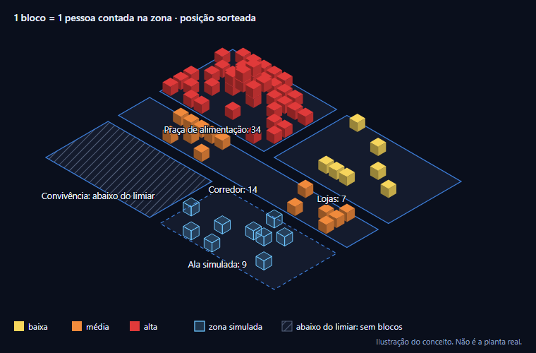
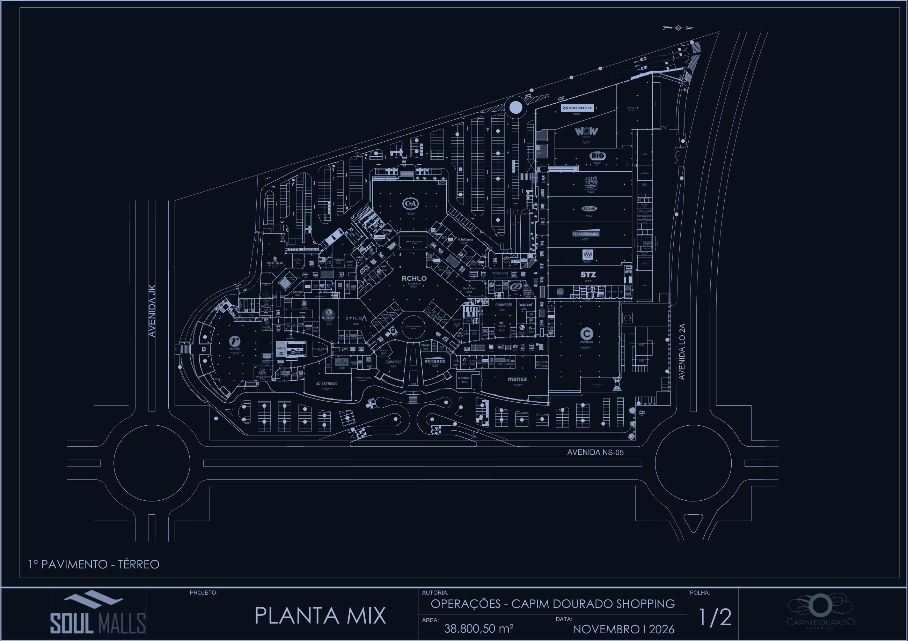
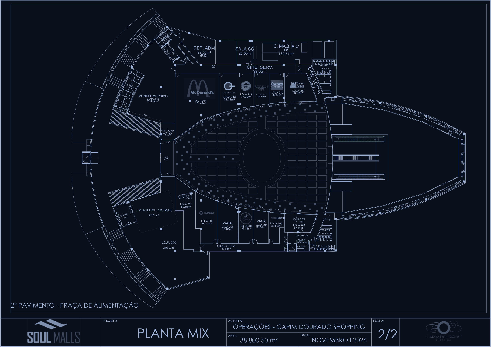
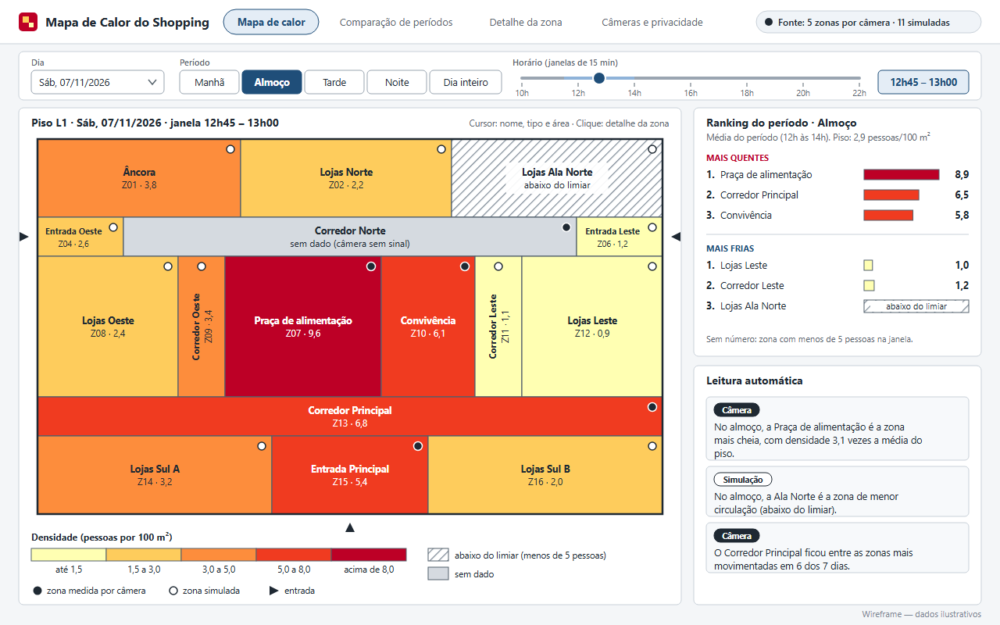
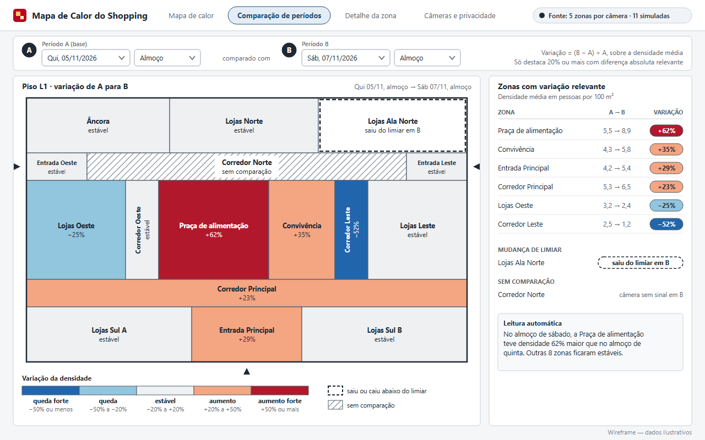
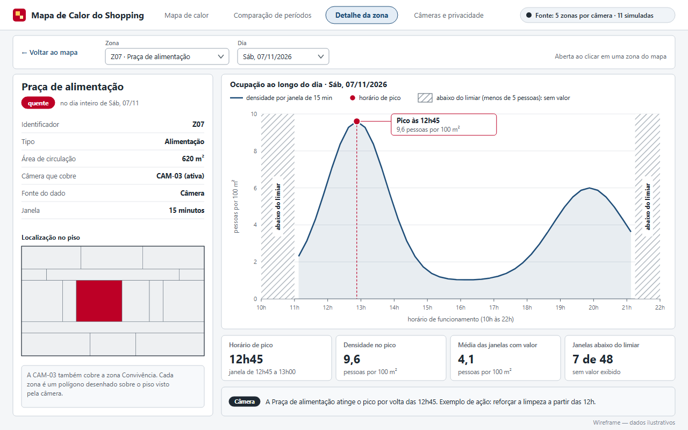
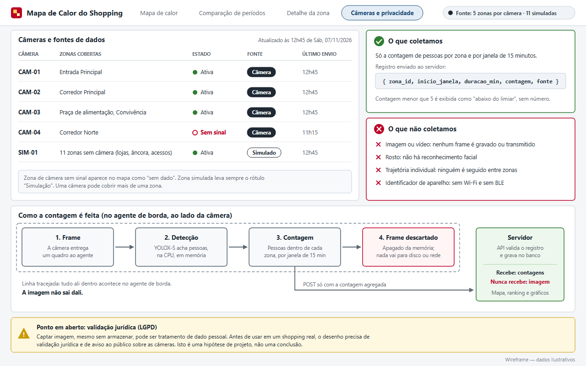
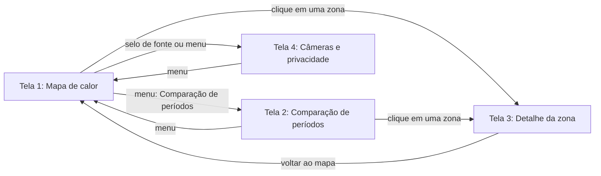
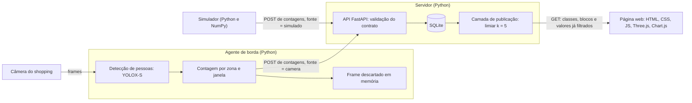
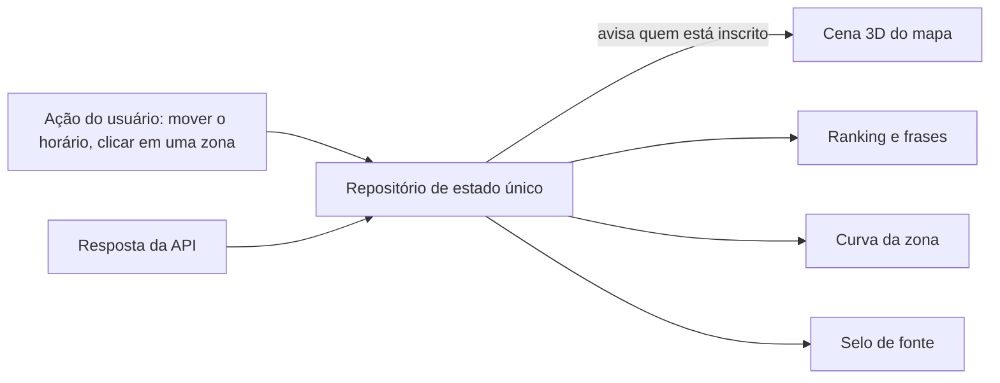

# Magneton

**Primeira entrega: planejamento técnico inicial**

| | |
|---|---|
| Evento | HackaRun |
| Desafio | 02: Inteligência sobre fluxo e movimentação de pessoas |
| Equipe | Magneton |
| Integrantes | Carlos Henrique Cardoso da Silva Rocha, Guilherme Leão Teles, Murillo Magnno de Sousa Rêis e Samuel da Silva Ramos de Souza |
| Data | 13/11/2026 |
| Repositório | https://github.com/murillomagnnosr/Magneton |

## Resumo

A administração do shopping quer saber onde as pessoas se concentram, quais espaços têm pouca circulação e como isso muda ao longo do dia. Nossa solução é um mapa de calor em 3D sobre a planta real do Capim Dourado Shopping: em vez de manchas de cor, cada zona recebe blocos (cubos) conforme o número de pessoas contadas ali. O mapa vem com ranking de zonas quentes e frias, comparação entre períodos e frases que leem o mapa para o gestor. A fonte de dados são as câmeras do shopping: um programa ao lado de cada câmera detecta pessoas, descarta a imagem na hora e envia só a contagem por zona e por janela de tempo. Nenhuma imagem é gravada ou transmitida, e não há reconhecimento facial nem trajetória individual. Este documento é o planejamento, não o MVP. O que já existe é um teste de detecção com a webcam de um notebook, descrito na seção 2.

## Como este documento atende à entrega

O documento segue os seis itens pedidos para a primeira entrega, na mesma ordem e com os mesmos títulos.

| Item pedido | Seção | Arquivos de apoio no repositório |
|---|---|---|
| Proposta e estrutura inicial das telas | 1 | `entrega-1/telas/`, `planta/`, `frontend-3d/FRONTEND-3D.md` |
| Documentação inicial do projeto | 2 | `REQUISITOS.md`, `validacao-camera/` |
| Linguagem de programação escolhida | 3 | |
| Arquitetura proposta | 4 | |
| Plataforma e tecnologias adotadas | 5 | `frontend-3d/FRONTEND-3D.md` |
| Descrição de como a tecnologia ou prática sorteada será incorporada à solução | 6 | |

---

## 1. Proposta e estrutura inicial das telas

São quatro telas em uma única aplicação web. As imagens abaixo são esboços iniciais da estrutura de cada tela.

**Mudança em relação aos esboços.** Nas telas 1 e 2, o centro da tela será uma cena 3D da planta real do shopping, com blocos no lugar das zonas pintadas. A ilustração abaixo mostra o conceito. Painéis, controles e navegação continuam como nos esboços. A planta 2D colorida dos esboços fica como alternativa para computador sem suporte a 3D. O detalhamento está em `frontend-3d/FRONTEND-3D.md`.



**Planta usada.** O piso da cena é a Planta Mix do Capim Dourado Shopping (novembro de 2026), em versão escura. São dois pisos: o térreo e o 2º pavimento, onde fica a praça de alimentação. Os arquivos estão em `planta/`.





### Tela 1: Mapa de calor

Responde: onde as pessoas estão concentradas agora, ou em um horário escolhido, e quais zonas estão vazias.

- Cena 3D com os dois pisos da planta (térreo e 2º pavimento, praça de alimentação). Cada zona recebe blocos conforme a contagem, na cor de uma de cinco classes de densidade. Zona "abaixo do limiar" e zona "sem dado" ficam sem blocos, com marcação própria.
- A posição de cada bloco dentro da zona é sorteada. Nenhum bloco indica onde uma pessoa estava.
- Controle deslizante de horário e seletor de período (manhã, almoço, tarde, noite, dia inteiro).
- Ranking das zonas mais quentes e mais frias do período.
- Frases de leitura automática, uma para cada pergunta do desafio.
- Marcador em cada zona indicando a fonte do dado (câmera ou simulado) e selo no topo com o total de zonas de cada fonte.



### Tela 2: Comparação de períodos

Responde: o que mudou entre dois períodos, por exemplo sábado contra terça-feira.

- Dois seletores (período A e período B), cada um com dia e faixa de horário.
- Mapa de diferença na mesma cena 3D, com os blocos em escala de azul (queda) a vermelho (aumento).
- Lista apenas das variações relevantes: 20% ou mais e também relevantes em valor absoluto.



### Tela 3: Detalhe da zona

Responde: como uma zona se comporta ao longo do dia e em que horário atinge o pico.

- Nome, tipo, área, câmera que cobre a zona e fonte do dado, com uma miniatura da planta mostrando onde a zona fica.
- Curva de ocupação do dia (Chart.js), com lacunas nas janelas abaixo do limiar.
- Horário de pico em destaque e quatro indicadores: horário de pico, densidade no pico, média das janelas com valor e número de janelas abaixo do limiar.



### Tela 4: Câmeras e privacidade

Responde: de onde vem cada número e o que o sistema coleta e não coleta.

- Estado de cada câmera (ativa, sem sinal, hora do último envio) e as zonas que ela cobre.
- Fonte de cada zona: câmera ou simulado.
- Quadro "o que coletamos" (os cinco campos do contrato) e "o que não coletamos" (imagem, rosto, trajetória, Wi-Fi, BLE).
- Limiar de exibição em vigor (k = 5) e janela de tempo.



### Fluxo de navegação



A Tela 1 é a página inicial. Um menu fixo no topo leva às quatro telas de qualquer ponto. A Tela 3 abre com a última zona escolhida.

---

## 2. Documentação inicial do projeto

**Problema.** A administração decide posição de quiosques, escala de limpeza e segurança e campanhas sem dados sobre onde as pessoas estão e quando.

**Objetivo.** Mostrar, sobre a planta, onde há concentração, onde há pouca circulação e como isso varia por período, sem identificar ninguém.

**Usuários.** Gestão comercial (quiosques e pontos), operações e segurança (escalas) e marketing (campanhas, antes e depois). O encarregado de dados do shopping não usa a tela no dia a dia, mas precisa conseguir conferir as regras de privacidade.

### Escopo do MVP

| Situação | Itens |
|---|---|
| Entra, funcionando | Agente de borda lendo ao menos uma câmera (a webcam do notebook na demo); API com validação do contrato; banco; as quatro telas; algoritmo de densidade, classes, ranking e comparação; limiar aplicado no servidor. |
| Planta | A planta real do Capim Dourado Shopping (Planta Mix, novembro de 2026), com dois pisos: térreo e 2º pavimento (praça de alimentação). Planta usada no projeto, em PDF e em imagem. |
| Simulado, com rótulo visível | Contagens das zonas sem câmera na demo. |
| Fica para depois | Câmeras reais do shopping, subsolos de estacionamento, previsão de pico, alertas, login e perfis, validação jurídica formal. |
| Fora por decisão | Reconhecimento facial, trajetória individual, visitantes únicos, Wi-Fi e BLE, gravação ou envio de imagem. |

### Requisitos Must

| ID | Requisito | Como se verifica |
|---|---|---|
| RF01 | Planta em 3D com blocos por zona, na cor da classe de densidade, com legenda da escala ("1 bloco = N pessoas"). | A cor e o número de blocos de 3 zonas de amostra conferem com o cálculo à mão. |
| RF02 | Escolher horário e período. | Mapa e ranking mudam ao mover o controle. |
| RF03 | Ranking de zonas quentes e frias do período. | Valores conferem com o cálculo manual. |
| RF04 | Contagem abaixo de k = 5 aparece como "abaixo do limiar", sem número. | Nenhuma resposta da API traz contagem entre 0 e 4, nem densidade calculada a partir dela. |
| RF05 | Toda zona mostra a fonte do dado; dado simulado nunca aparece como real. | Selo visível no mapa e em cada painel. |
| RF06 | A API aceita só os cinco campos do contrato. | Teste envia campo extra (por exemplo `imagem`) e espera rejeição. |
| RF07 | O agente de borda envia só contagens e não grava imagem. | Revisão do código e teste: o único dado que sai do agente é o JSON do contrato. |
| RF08 | O simulador preenche as zonas sem câmera no mesmo contrato. | Com semente fixa, gera sempre o mesmo resultado. |

O documento completo é o `REQUISITOS.md`, na raiz do repositório, com 17 requisitos funcionais, 14 não funcionais, algoritmo, riscos e plano. **Aviso:** ele foi escrito antes das decisões de usar câmeras e de mostrar o mapa em 3D, e ainda descreve o simulador como fonte principal, uma página sem API e uma planta fictícia em 2D. Ele será atualizado. O desenho da interface 3D está em `frontend-3d/FRONTEND-3D.md`. Onde houver conflito, vale este documento. A tabela acima já está adaptada (RF07 e RF08 são novos em relação a ele).

### Algoritmo, em resumo

- Densidade = contagem ÷ área da zona.
- Cinco classes de cor por quantis fixos (P20, P40, P60, P80), calculados uma vez sobre todo o conjunto. A mesma cor significa a mesma densidade em qualquer horário.
- Zona quente: média do período no percentil 80 ou acima. Zona fria: no percentil 20 ou abaixo.
- A comparação só destaca variação de 20% ou mais que também seja relevante em valor absoluto. Isso evita anunciar "aumento de 100%" quando uma zona foi de 1 para 2 pessoas.
- Janela de 15 minutos em produção.
- Blocos: o servidor converte a contagem de cada zona em número de blocos, com uma escala única para todo o conjunto de dados (1, 2, 5 ou 10 pessoas por bloco). Zona abaixo do limiar não recebe bloco.

### Validação já feita (12/11/2026)

Testamos a detecção com a webcam de um notebook. Os resultados são reais, mas o teste é limitado.

| Medida | Resultado |
|---|---|
| Velocidade do YOLOX-S em CPU, em 1280x720 | cerca de 4,5 frames por segundo, sem falha de leitura |
| Medição 1 (3 min) | média de 2,16 pessoas por frame; máximo de 9 ao mesmo tempo |
| Mapa de calor em 9 zonas (grade 3x3), duas medições de 3 min | "Centro/Base" foi a zona mais movimentada nas duas: 58,6% e 54,7% da ocupação |
| Segunda medição | "Esquerda/Base" teve 38,2% da ocupação |

Limites do teste:

- A webcam fica de frente e na altura do rosto. Uma câmera de shopping fica no alto, e o desempenho da detecção pode ser diferente.
- As zonas eram regiões da imagem, não áreas do piso.
- Os números não foram conferidos contra contagem manual.
- A estimativa de pessoas distintas (33) tende a estar inflada. O projeto não usa essa medida.

Scripts e resultados estão em `validacao-camera/` (`contar_pessoas.py`, `mapa_calor_camera.py`, `mapa_calor.json`, `mapa_calor_2.json`).

### Próximos passos até a entrega final

1. Escrever o repositório de estado da interface (`estado.js`) e o teste das ações, antes das telas.
2. Atualizar o `REQUISITOS.md` para as decisões das câmeras e do mapa em 3D.
3. Congelar o contrato de dados e traçar as zonas sobre a planta real (`zonas.json`).
4. Montar o caminho de ponta a ponta: webcam, agente de borda, API, banco e mapa para uma janela, primeiro na alternativa 2D e depois na cena 3D.
5. Completar as quatro telas, o simulador e os testes de privacidade.
6. Conferir a contagem do agente contra uma contagem manual em um trecho curto.
7. Ensaiar a demo e gravar um vídeo de reserva.

### Riscos principais

- **Jurídico.** O ponto sobre validação jurídica na seção 4 ainda não tem resposta. Sem ela, a solução não pode ir para um shopping real.
- **Precisão.** Pelos limites do teste descritos na seção 2, a precisão em um shopping real é desconhecida.
- **Demo.** Com poucas pessoas diante da webcam, a zona real tende a ficar "abaixo do limiar" (k = 5), e com janela de 15 minutos quase nada muda durante a apresentação. O grupo ainda precisa decidir como mostrar isso sem esconder a regra.
- **Prazo.** A arquitetura tem mais peças do que o plano anterior (borda, API, banco e cena 3D). O caminho de ponta a ponta vem antes de qualquer melhoria, e a alternativa 2D fica pronta antes do 3D, para existir uma tela de demo se o 3D atrasar.

### Documentos de apoio

- `REQUISITOS.md`: requisitos completos, algoritmo detalhado, riscos e plano de trabalho.
- `frontend-3d/FRONTEND-3D.md`: desenho da interface 3D com blocos.
- `validacao-camera/`: scripts e resultados do teste de detecção com a webcam.
- `planta/`: Planta Mix em PDF e em imagem, nas versões clara e escura.

---

## 3. Linguagem de programação escolhida

| Linguagem | Onde é usada | Por quê |
|---|---|---|
| **Python** | Agente de borda, API, simulador e testes (pytest). | Tem as bibliotecas de visão e de dados de que precisamos (OpenCV, onnxruntime, NumPy, FastAPI). É a linguagem em que todos os integrantes têm mais prática. O teste da webcam já foi feito nela. Usar uma só linguagem em todo o lado do servidor reduz o número de peças. |
| **JavaScript** | Interface no navegador. | É a linguagem nativa do navegador e a da biblioteca 3D (Three.js). Não usamos framework de interface nem etapa de compilação, para ter menos coisas que possam quebrar na demo. |

---

## 4. Arquitetura proposta



### Componentes

- **Câmera.** Câmera do shopping. Na demo, a webcam do notebook.
- **Agente de borda.** Programa em Python que roda perto da câmera. Lê o frame com OpenCV, detecta pessoas com o YOLOX-S (formato ONNX, em CPU, com onnxruntime), verifica em qual zona cada pessoa está e soma. O frame é descartado em memória. A cada janela, envia a contagem por zona. Cada câmera cobre uma ou mais zonas, desenhadas como polígonos sobre o piso que ela enxerga e ligadas às zonas da planta.
- **Simulador.** Gera contagens no mesmo contrato para as zonas sem câmera na demo, sempre com `fonte = "simulado"`.
- **API.** FastAPI. Recebe as contagens, valida com Pydantic e rejeita qualquer campo fora do contrato. Também serve a página web.
- **Banco.** SQLite, um arquivo local, sem instalação.
- **Camada de publicação.** Parte da API que calcula densidade, classes, ranking, comparação e número de blocos por zona, e aplica o limiar.
- **Interface.** Página estática que só desenha o que a API devolve: uma cena 3D (Three.js) com a planta do shopping e os blocos, mais os painéis. Sem suporte a 3D no navegador, mostra a planta 2D em SVG.

### Contrato de dados

É o único formato que entra no servidor, vindo da câmera ou do simulador:

```json
{
  "zona_id": "Z07",
  "inicio_janela": "2026-11-13T12:00",
  "duracao_min": 15,
  "contagem": 60,
  "fonte": "camera"
}
```

`contagem` é a média de pessoas presentes na zona durante a janela, arredondada para inteiro. `fonte` aceita apenas `camera` ou `simulado`. Não existe campo nem rota para imagem, vídeo ou identificador de pessoa ou aparelho.

### Onde o limiar de privacidade é aplicado

No servidor, antes de responder à interface. O banco guarda a contagem recebida. A camada de publicação troca toda contagem abaixo de k = 5 por "abaixo do limiar", sem número. O navegador nunca recebe o valor bruto. Zero e valores de 1 a 4 caem na mesma classe, para a tela não revelar se havia alguém.

Captar imagem, mesmo sem armazenar, pode ser tratamento de dado pessoal. O uso das câmeras para esse fim precisa de validação jurídica e de aviso ao público. Não afirmamos que a solução está em conformidade com a LGPD. Afirmamos que ela foi desenhada para reduzir o dado ao mínimo.

---

## 5. Plataforma e tecnologias adotadas

**Plataforma:** aplicação web, usada no navegador, sem instalação para o usuário. Na demo, tudo roda em um notebook, sem serviço pago. O código fica no GitHub.

| Camada | Tecnologia | Motivo |
|---|---|---|
| Captura de vídeo | OpenCV | Lê câmera e webcam com poucas linhas. Já usado no teste. |
| Detecção de pessoas | YOLOX-S em ONNX, com onnxruntime em CPU | Modelo aberto, roda sem placa de vídeo. Medimos cerca de 4,5 frames por segundo em um notebook. |
| Simulador | Python com NumPy | Sorteios reprodutíveis com semente fixa. |
| API | FastAPI | Poucas linhas por rota e documentação automática. |
| Validação | Pydantic | O contrato fechado vira declaração curta, e a rejeição de campo extra pode ser mostrada ao vivo. |
| Banco | SQLite | Um arquivo, sem servidor de banco. Suficiente para a demo. |
| Interface | HTML, CSS e JavaScript, sem framework de interface | Sem etapa de compilação. |
| Mapa 3D | Three.js, guardado em pasta local do projeto (com `OrbitControls`, `EffectComposer`, `UnrealBloomPass` e `OutputPass`) | Desenha a planta e milhares de blocos com poucas chamadas de desenho (`InstancedMesh`). Funciona sem internet. |
| Estado da interface | Repositório de estado único em JavaScript puro (`estado.js`) | É a prática sorteada (seção 6). Mantém as quatro telas no mesmo dia, período e zona. |
| Planta | Imagem da Planta Mix como textura do piso, e `zonas.json` com o polígono de cada zona | As zonas são traçadas sobre a planta real. O mesmo arquivo alimenta a alternativa 2D em SVG. |
| Gráfico | Chart.js | Gráfico de linha com suporte a lacunas, para a curva da zona. |
| Testes | pytest (Python) e `node --test` (repositório de estado) | Os requisitos de privacidade e as ações do estado viram testes que rodam com um comando. |
| Versionamento | Git e GitHub | O código do grupo fica em um repositório único, com histórico. |

---

## 6. Descrição de como a tecnologia ou prática sorteada será incorporada à solução

**O que foi sorteado.** Na Roleta das Tecnologias, a equipe ficou com três opções (Estado, Variáveis de ambiente e Firebase) e escolheu **Estado: gerenciamento de estado organizado na interface** (categoria Frontend e Desenvolvimento).

**Por que essa escolha.** As quatro telas mostram o mesmo recorte de dados: o dia, o período, a janela de horário e a zona selecionada. Se cada tela guardasse esses valores por conta própria, o mapa poderia mostrar o almoço enquanto o ranking mostra a tarde. Organizar o estado resolve um problema que o projeto já teria.

**Em qual componente entra.** Na interface (página web). Borda, API e banco não mudam.

**Como será incorporado.** A interface terá um único repositório de estado (`estado.js`), escrito em JavaScript puro, com fluxo em uma só direção:



- **Uma fonte de verdade.** O estado é um objeto só. Nenhum componente guarda cópia própria de dia, período ou zona.
- **Mudança só por ação nomeada.** O estado não é alterado direto. Cada mudança passa por uma função com nome, por exemplo `selecionarJanela`, `selecionarPeriodo`, `selecionarZona`, `definirComparacao` e `receberDados`.
- **Telas como função do estado.** Cena 3D do mapa, ranking, frases, curva e selo se inscrevem no repositório e se redesenham quando a parte que usam muda. Nenhum componente altera outro diretamente.
- **Estado de carregamento explícito.** Cada pedido à API tem situação `carregando`, `pronto` ou `erro`, e a tela mostra cada uma. Câmera sem sinal vira "sem dado" a partir do estado, não de uma verificação espalhada pelo código.
- **Estado refletido no endereço.** Dia, período e zona vão para a URL, de modo que recarregar a página ou compartilhar o link abre a mesma visão.

Forma do estado:

```json
{
  "filtro": { "dia": "2026-11-07", "periodo": "almoco", "janela": "12:45" },
  "zonaSelecionada": "Z07",
  "piso": "terreo",
  "camera": "geral",
  "animacao": "rodando",
  "comparacao": { "a": null, "b": null },
  "dados": { "situacao": "pronto", "zonas": [], "ranking": [], "frases": [] },
  "fontes": { "camera": 5, "simulado": 11 }
}
```

Os números de `fontes` são ilustrativos, os mesmos dos esboços de tela. Os campos `piso`, `camera` e `animacao` existem por causa da cena 3D: qual piso está visível, qual visão de câmera está ativa e se a animação está rodando ou pausada.

**O que muda no plano.** Entra um arquivo novo na interface (`estado.js`) e uma regra de código: componente não fala com componente, só com o repositório. A cena 3D segue a mesma regra: ela não guarda dia, período nem zona, só desenha o que o estado manda. O repositório de estado não usa biblioteca: é pequeno e escrito pelo grupo, o que mantém a decisão de não usar framework. Se a interface crescer, a alternativa é a versão sem framework da biblioteca Zustand.

**Como será demonstrado na entrega final.**

- Mover o controle de horário uma vez e ver os blocos da cena 3D, o ranking e as frases mudarem juntos.
- Clicar em uma zona na Tela 1, abrir a Tela 3 e ver a mesma zona e o mesmo dia, sem escolher de novo.
- Recarregar a página e voltar à mesma visão, pelo endereço.
- Mostrar o teste automatizado do repositório: cada ação produz o estado esperado, sem depender da tela.
