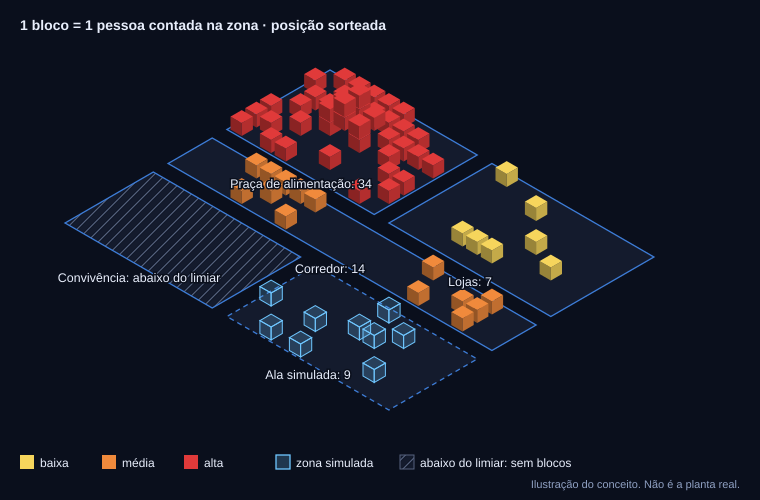

# Frontend 3D: mapa do Capim Dourado Shopping em blocos

**Adaptação da engenharia reversa do hackarun.com.br ao projeto do desafio 02 (fluxo e movimentação de pessoas).**
Escrito em 13/11/2026. Fontes: o documento "Engenharia reversa: hackarun.com.br" e a Planta Mix do Capim Dourado Shopping (Operações, novembro de 2026, 38.800,50 m², folhas 1/2 e 2/2).

Marcações: **[Suposição]** é algo adotado sem confirmação. **[A medir]** é valor que sai da planta quando as zonas forem traçadas.

## Resumo

A interface deixa de ser uma planta 2D pintada por manchas de cor e passa a ser a planta real do shopping em 3D, com **blocos** (cubos, no estilo de jogo de blocos) representando as pessoas contadas em cada zona. Mais blocos em uma zona significa mais gente ali. A cor do bloco continua indicando a classe de densidade, então a informação do mapa de calor não se perde.

Do site de referência aproveitamos o motor 3D (Three.js), o brilho de pós-processamento, a régua lateral de progresso, o botão de pausa, as fontes e o cuidado com desempenho e fallback. Não aproveitamos o que serve a uma página de divulgação que rola (scroll suave, animações presas ao scroll, raios no logo), porque a nossa tela é um painel de operação.

Borda, banco e contrato de entrada não mudam. Na API muda só a resposta da camada de publicação, que passa a devolver também o número de blocos por zona e a escala de pessoas por bloco. O resto da mudança é na interface.



## 1. Resumo da stack

| No site de referência | Decisão no projeto | Para que é usada aqui |
|---|---|---|
| Astro + Vite (site estático com build) | **Não adotado.** Página servida pela API, sem etapa de build. Three.js entra como módulo ES, por `importmap` com duas entradas (`three` e `three/addons/`). Em `vendor/three/` ficam as pastas `build/` e `examples/jsm/` inteiras, da mesma versão. A página é aberta sempre pelo endereço da API, nunca por `file://`, e a API registra o tipo `text/javascript` para `.js` antes de servir os arquivos. | Mantém a decisão de não usar framework e a demo sem internet. |
| Three.js r186, `THREE.Points` com shader próprio | **Adotado, com outra técnica.** Mesma biblioteca, versão fixada e guardada em `vendor/`. Em vez de partículas, `InstancedMesh` de cubos. | Toda a cena: piso com a planta, zonas e blocos. |
| Morph de partículas entre formas (`uFrom`, `uTo`, `uT`) | **Adaptado.** A transição é entre duas janelas de tempo: blocos entram, saem e mudam de cor quando o horário muda. | Mostrar como a movimentação muda no tempo. |
| GSAP ScrollTrigger + Lenis | **Não adotado.** Não há página rolando. As transições de câmera e de blocos usam interpolação própria dentro do laço de animação. | Evita duas bibliotecas sem uso. |
| Web Workers para gerar formas | **Não adotado no MVP.** São poucos milhares de blocos, calculados na thread principal. | Fica como opção se a cena crescer. |
| Gerador aleatório com semente fixa | **Adotado.** A posição de cada bloco dentro da zona vem de um sorteio com semente fixa. | O desenho é igual a cada recarga e não treme entre quadros. |
| `EffectComposer` + `UnrealBloomPass` | **Adotado, moderado.** Brilho nas zonas mais cheias. Desligado no nível de qualidade baixo. | O aspecto "tecnológico" do site de referência. |
| Aurora de fundo com paleta por cena | **Adaptado, opcional.** O tom do fundo acompanha o período (manhã, almoço, tarde, noite). Feito em CSS. | Reforça em que parte do dia a tela está. |
| Raios no logo, feixes de luz | **Não adotado.** | Enfeite sem relação com o dado. |
| Onda de choque da "carga" | **Adaptado, opcional.** Vira o pulso de alerta de lotação em uma zona (RF14, prioridade Could). | Chamar atenção para uma zona acima do limite. |
| HUD lateral com 12 marcas | **Adaptado.** Vira a régua de tempo do dia: uma marca por hora, das 10h às 22h. | Controle de horário. |
| Botão de pausa e `prefers-reduced-motion` | **Adotado.** Pausa a reprodução do dia e as animações. | Acessibilidade e controle na demo. |
| Níveis de qualidade pela GPU, `?quality=` | **Adotado, simplificado.** Dois níveis: `alto` e `baixo`, com escolha manual por `?qualidade=`. | A demo roda em notebook sem placa de vídeo dedicada. |
| Fallback sem WebGL2 | **Adotado.** Sem WebGL2, a tela mostra a planta 2D em SVG já prevista na primeira entrega. | A demo não depende do 3D para funcionar. |
| Fontes Orbitron, Montserrat, JetBrains Mono | **Adotado**, com os arquivos `.woff2` na própria pasta do projeto. | Títulos, texto e números da régua. |
| Vidro fosco, cantos recortados (`backdrop-filter`, `clip-path`) | **Adotado** nos painéis sobre a cena. | Painéis de ranking, frases e detalhe da zona. |
| Google Apps Script como backend | **Não se aplica.** O backend é a API em FastAPI já definida. | |
| Cloudflare, CSP, SEO | **Fora do MVP.** A demo roda em um notebook. | |

## 2. Elementos 3D (foco principal)

### 2.1 A cena: a planta do shopping como piso

A cena tem dois pisos, tirados das duas folhas da planta:

- **1º pavimento, térreo** (folha 1/2): mall, lojas, âncoras, praças de eventos e acessos.
- **2º pavimento, praça de alimentação** (folha 2/2): salão de mesas, lojas 200 a 216 e esteiras rolantes.

Cada piso é um plano com a imagem da planta aplicada como textura, em versão escura (linhas claras sobre fundo escuro). Sobre o plano ficam as zonas, que são polígonos invisíveis usados para posicionar os blocos e para detectar o clique. O 2º pavimento fica acima do térreo, com um vão que deixa os dois visíveis. Um seletor mostra só o térreo, só o 2º pavimento ou os dois.

Levantar as paredes das lojas em 3D (`ExtrudeGeometry` a partir dos polígonos) é opcional. O primeiro objetivo é piso com planta e blocos.

Os subsolos de estacionamento aparecem na folha geral, mas ficam fora do escopo.

### 2.2 Blocos: como a contagem vira cubos

Regras:

1. **O bloco representa contagem, não posição.** A API devolve, para cada zona e janela, quantos blocos desenhar. O lugar de cada bloco dentro da zona é sorteado pela interface. Nenhum bloco indica onde uma pessoa estava. Essa frase aparece na legenda da tela.
2. **Um bloco vale um número fixo de pessoas**, mostrado na legenda ("1 bloco = 1 pessoa"). A escala (1, 2, 5 ou 10 pessoas por bloco) é calculada uma única vez no servidor, para todo o conjunto de dados: é a menor em que a janela mais cheia, somando os dois pisos e contando só zonas com contagem igual ou maior que k, cabe no limite de blocos da cena. Ela não muda ao trocar de janela nem durante a reprodução do dia. O número de blocos da zona é a contagem dividida pela escala, arredondada para cima, de modo que toda zona acima do limiar tem pelo menos um bloco.
3. **Abaixo do limiar não há blocos.** Zona com contagem menor que k = 5 aparece com o contorno hachurado e o texto "abaixo do limiar". Zero e valores de 1 a 4 têm a mesma aparência, como já definido no projeto. Zona sem dado (câmera sem sinal) também fica sem blocos, mas com o piso em cinza liso, sem hachura, e o texto "sem dado". Em zona simulada, o rótulo "Simulação" aparece mesmo quando não há blocos.
4. **A cor do bloco é a classe de densidade** (as mesmas cinco classes, por quantis fixos). A quantidade de blocos mostra quantas pessoas. A cor e o quanto os blocos se apertam e empilham mostram a densidade. Assim a densidade não depende só da cor.
5. **Zona simulada tem bloco diferente**: cubo translúcido e o rótulo "Simulação". Dado simulado nunca aparece igual a dado de câmera.
6. **Quando a zona enche, os blocos empilham.** Cada zona é coberta por uma grade de células de 2,5 m, com cubos de 2 m **[Suposição, a ajustar na tela]**. Os blocos ocupam primeiro as células livres e depois sobem em camadas. Como o número de células vem da área, a altura da pilha acompanha a densidade, a mesma grandeza da cor. O tamanho do cubo é só visual: ele precisa ser grande para aparecer na visão geral de uma planta com centenas de metros de lado.

Onde cada regra é aplicada:

| Regra | Onde |
|---|---|
| Limiar k = 5, escala e número de blocos por zona | No servidor, na camada de publicação. A interface nunca recebe a contagem bruta. |
| Posição do bloco dentro da zona | Na interface, por sorteio com semente fixa por zona. |
| Cor, pilha, contorno de zona simulada | Na interface, a partir da classe e da fonte que a API devolve. |

Técnica: os blocos são dois `InstancedMesh` com a mesma `BoxGeometry`. Um tem material sólido, para dado de câmera. O outro tem material translúcido (`transparent: true`, opacidade baixa, `depthWrite: false`), para zonas simuladas. A posição de cada instância vai por `setMatrixAt` e a cor por `setColorAt`, com a cor do material em branco, porque a cor da instância multiplica a do material. São duas chamadas de desenho para milhares de cubos.

Três detalhes sem os quais a animação não aparece:

- Cada `InstancedMesh` é criado já com a capacidade do limite de blocos. A quantidade desenhada é controlada por `mesh.count`.
- Depois de alterar matrizes ou cores, marcar `instanceMatrix.needsUpdate = true` e `instanceColor.needsUpdate = true`.
- Como os blocos mudam de lugar, usar `frustumCulled = false`.

O limite inicial é de 5.000 blocos na cena **[Suposição, a ajustar no notebook da demo]**.

### 2.3 Animação entre janelas de tempo

É a adaptação do morph de partículas do site de referência. Lá, cada partícula ia da forma atual para a próxima. Aqui, cada zona vai da quantidade de blocos da janela atual para a da janela seguinte:

- Blocos novos caem de cima até o lugar deles.
- Blocos que saem encolhem e somem.
- Blocos que ficam mudam de cor aos poucos, se a classe da zona mudou.
- Entre uma troca e outra, os blocos fazem um pequeno movimento no próprio lugar, para a cena não parecer congelada. Esse movimento é decorativo e é desligado pelo botão de pausa e por `prefers-reduced-motion`.

A reprodução do dia (RF12) percorre as 48 janelas e vira a animação principal da demo: dá para ver a praça de alimentação encher no almoço e esvaziar à tarde.

### 2.4 Câmera e interação

- **Câmera em perspectiva** com `OrbitControls`: girar, aproximar e afastar. O ângulo é limitado para a câmera não passar por baixo do piso.
- **Visões prontas**: geral, térreo, praça de alimentação. A câmera vai de uma para outra por interpolação.
- **Clique em uma zona** (`Raycaster` só sobre as malhas das zonas, feitas com `ShapeGeometry` e material invisível): a câmera se aproxima e abre o painel de detalhe, com a curva do dia e o horário de pico. Só conta como clique se o ponteiro andou menos de 5 px entre apertar e soltar, para não confundir com o giro da câmera.
- **Cursor sobre a zona**: nome, tipo, área e fonte do dado.
- **Rótulos** das zonas principais em HTML sobre a cena (`CSS2DRenderer`, com `render` próprio a cada quadro e a camada com `pointer-events: none`), para o texto ficar nítido sem bloquear o mouse.

### 2.5 Visual tecnológico

- Fundo escuro, com os blocos em cores vivas.
- `UnrealBloomPass` seguido de `OutputPass`. O limiar do brilho fica logo abaixo da luminância das cores das duas classes mais altas e acima de todo o resto. As linhas da planta usam cinza médio, abaixo do limiar, para não brilharem antes dos blocos. Os blocos usam `MeshBasicMaterial`, para a cor na tela ser a cor da classe. Na Tela 2 o brilho fica desligado.
- Para as zonas quentes brilharem mais, a paleta de cinco classes é refeita para fundo escuro, com as classes mais altas mais luminosas **[Suposição: muda a tabela de cores do `REQUISITOS.md` e precisa passar de novo na verificação de daltonismo]**.
- Painéis de vidro fosco sobre a cena para ranking, frases automáticas e detalhe da zona.
- Tom do fundo conforme o período do dia (opcional).

### 2.6 Qualidade e fallback

| Nível | O que muda |
|---|---|
| `alto` | Bloom ligado, resolução de até 2x, movimento decorativo dos blocos. |
| `baixo` | Sem bloom, resolução 1x, sem movimento decorativo. |
| Sem WebGL2 ou erro no 3D | A tela troca para a planta 2D em SVG, com as mesmas cores por classe. |

O laço de animação para quando a aba fica oculta.

## 3. Demais elementos

### 3.1 Régua de tempo (adaptação do HUD lateral)

A régua lateral do site de referência marcava as seções da página. Aqui ela marca as horas do dia, das 10h às 22h, com as 48 janelas de 15 minutos. Arrastar o marcador troca a janela. O preenchimento acompanha a reprodução do dia. Uma região `aria-live` anuncia a janela atual para leitores de tela.

### 3.2 Estado da interface (a prática sorteada)

A cena 3D é mais um inscrito do repositório de estado (`estado.js`), igual ao ranking e às frases. Ela não guarda dia, período nem zona por conta própria: desenha o que o estado manda. O estado ganha três campos:

```json
{
  "piso": "terreo",
  "camera": "geral",
  "animacao": "rodando"
}
```

Valores de `piso`: `terreo`, `l2` ou `ambos`. Valores de `animacao`: `rodando` ou `pausada`. Com isso, o clique em uma zona na cena, a troca de horário na régua e o painel de detalhe continuam sempre no mesmo recorte de dados, que é o motivo de a equipe ter escolhido essa prática.

### 3.3 Telas

As quatro telas da primeira entrega continuam valendo. Muda o centro da Tela 1 e da Tela 2: no lugar da planta 2D colorida entra a cena 3D com blocos. Na Tela 2 (comparação), a diferença entre dois períodos aparece na cor dos blocos (azul para queda, vermelho para aumento). A quantidade de blocos é a média do período B e só aparece quando esse período é publicável, isto é, quando todas as suas janelas têm contagem igual ou maior que k, como já exige o RNF02. Nos demais casos a zona fica sem blocos, com o contorno hachurado e o texto da situação (saiu do limiar, caiu abaixo do limiar ou sem comparação).

### 3.4 Acessibilidade

- Botão de pausa visível e respeito a `prefers-reduced-motion`.
- A informação nunca depende só da cor: o empilhamento dos blocos, o ranking em texto e as frases automáticas também indicam as zonas mais densas.
- O ranking e as frases são HTML comum, legíveis sem o 3D.

## 4. Da planta em PDF à cena

A Planta Mix é um PDF vetorial com as duas folhas de que precisamos. O caminho proposto:

1. **Exportar cada folha como imagem** de alta resolução e gerar a versão escura para servir de textura do piso.
2. **Calibrar a escala**: marcar dois pontos cuja distância está cotada na planta e calcular quantos pixels valem um metro. A folha geral indica 1/500 para a planta baixa do 2º pavimento, mas a calibração por cota é mais segura.
3. **Traçar as zonas** como polígonos sobre a imagem (no Inkscape ou em uma página simples de marcação) e gravar em `zonas.json`, com as coordenadas em metros.
4. **Preencher a área de cada zona.** Para as praças de eventos, a planta já traz o valor. Para corredores, a área sai do polígono traçado.
5. **Ligar cada zona à câmera** que a cobre, ou marcar como simulada.

Formato de uma zona:

```json
{
  "id": "Z07",
  "nome": "Praça de alimentação: salão de mesas",
  "piso": "l2",
  "tipo": "alimentacao",
  "area_m2": 0,
  "poligono": [[0, 0], [0, 0], [0, 0]],
  "fonte": "simulado"
}
```

Os zeros são marcadores: `area_m2` e `poligono` são **[A medir]**.

### Zonas propostas

Só entram áreas de circulação pública. A lista abaixo é o ponto de partida e será confirmada ao traçar.

| Piso | Zona | Área |
|---|---|---|
| Térreo | Praças de eventos: cinco áreas rotuladas na planta | 265,90 m², 207,36 m², 110,10 m², 51,89 m² e 50,00 m² |
| Térreo | Alameda das Cores | [A medir] |
| Térreo | Corredores do mall, divididos em trechos | [A medir] |
| Térreo | Acessos de pedestres (P1, P2, P3) | [A medir] |
| Térreo | Frente das lojas âncora | [A medir] |
| 2º pavimento | Praça de alimentação: salão de mesas | [A medir] |
| 2º pavimento | Frente das lojas 200 a 216 | [A medir] |
| 2º pavimento | Chegada das esteiras rolantes | 82,00 m² cada esteira, conforme a planta |

Os quiosques (Q 1 a Q 34) ficam dentro dos corredores e não viram zonas próprias. O interior das lojas fica fora: a contagem é das áreas comuns **[Suposição: as câmeras do shopping cobrem o mall, não o interior das lojas]**.

### Áreas que não entram

A planta mostra áreas que o projeto já proíbe como zona, por privacidade: sanitários, Espaço Família, ambulatório, vestiários, refeitório, salas de segurança e CFTV, docas, depósitos e corredores de serviço. Elas aparecem na textura do piso, mas nunca recebem blocos nem contagem.

### Cuidado com a planta

A Planta Mix é um documento interno da operação do shopping. Antes de colocar o PDF ou a imagem em um repositório público, confirmar com a organização se isso é permitido. Enquanto não houver resposta, a imagem fica fora do repositório, e o repositório leva só o `zonas.json`.

## 5. O que muda nos documentos já entregues

| Documento | O que fica desatualizado |
|---|---|
| `ENTREGA-1.md`, seção 1 | Os esboços mostram planta 2D colorida. As telas 1 e 2 passam a ter a cena 3D. |
| `ENTREGA-1.md`, seção 2 | O escopo diz que a planta é fictícia e deixa "vários pisos" para depois. Agora é a planta real do Capim Dourado, com dois pisos. |
| `ENTREGA-1.md`, seção 3 | A frase "pintar o mapa é trocar a cor de um elemento do SVG" vale só para o fallback. |
| `ENTREGA-1.md`, seção 4 | A resposta da camada de publicação ganha o número de blocos por zona e a escala. O contrato de entrada e o ponto de aplicação do limiar não mudam. A página web passa a incluir Three.js. |
| `ENTREGA-1.md`, seção 5 | Entra Three.js (com `OrbitControls`, `EffectComposer`, `UnrealBloomPass` e `OutputPass`). A linha "Planta: SVG" vira o fallback. |
| `ENTREGA-1.md`, seção 6 | O estado ganha `piso`, `camera` e `animacao`. A frase "As telas da seção 1 não mudam. Não entra biblioteca nova" deixa de valer para as telas 1 e 2 e para o Three.js. O repositório de estado continua sem biblioteca. |
| `REQUISITOS.md`, requisitos | RF01 (zona colorida) passa a ser "blocos por zona, coloridos pela classe". RF05 perde o trecho "PLANTA FICTÍCIA" do selo; os dados simulados continuam rotulados. RF15 (visão suavizada) sai. |
| `REQUISITOS.md`, escopo | A suposição S4 e a seção 6.1 (planta fictícia, um piso, 16 zonas) e o item "vários pisos" da lista de fora do escopo ficam desatualizados. |
| `REQUISITOS.md`, seção 7.1 | A carga dos scripts passa de scripts clássicos para módulos ES com `importmap`, servidos pela API. A tabela de cores muda para a paleta de fundo escuro, usada também no fallback. |

## 6. Ordem de construção

1. Piso do térreo com a textura da planta, câmera com `OrbitControls` e uma zona com blocos de quantidade fixa.
2. `zonas.json` com as praças de eventos e a praça de alimentação.
3. Fallback: planta 2D em SVG com as zonas de `zonas.json` coloridas por classe, ligada à API e ao estado. Fica pronta antes de avançar no 3D.
4. Blocos vindos da API para uma janela. Régua de tempo ligada ao estado. Troca de janela com blocos entrando e saindo.
5. Clique na zona, painel de detalhe, ranking e frases sobre a cena.
6. Segundo piso, visões prontas de câmera, reprodução do dia.
7. Bloom, vidro fosco e fontes.
8. Opcionais: paredes extrudadas, tom do fundo por período, pulso de alerta.

Os itens 1 a 3 vêm antes de qualquer acabamento visual. Se o 3D atrasar, o fallback do item 3 é a tela da demo.

## 7. Riscos

- **Prazo.** O 3D é mais trabalho de interface do que a planta 2D. A ordem acima deixa o enfeite por último.
- **Leitura errada dos blocos.** Alguém pode entender que cada bloco é uma pessoa naquele ponto. A legenda diz que a posição é sorteada, e os blocos não imitam figura humana.
- **Desempenho.** Notebook sem placa de vídeo dedicada pode não sustentar o bloom. O nível `baixo` e o fallback cobrem isso, mas precisam ser testados no notebook da demo.
- **Traçado das zonas.** É trabalho manual sobre a planta. Começar pelas praças, que já têm área na planta.
- **Uso da planta.** Depende da autorização citada na seção 4.
- **Demo com a webcam.** Continua valendo o risco já registrado: com poucas pessoas, a zona da câmera fica abaixo do limiar e sem blocos. O grupo ainda precisa decidir como mostrar isso.
